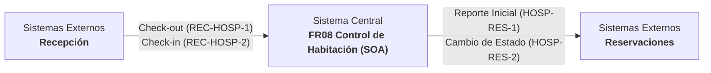
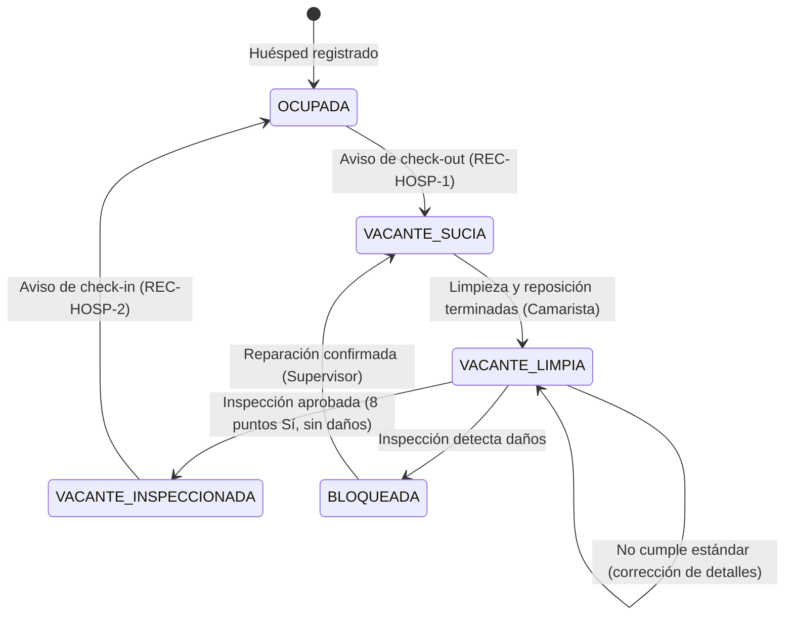

# Arquitectura del Sistema — FR08 Control de Habitaciones

Este documento describe la arquitectura orientada a servicios (SOA), los contratos de integración y la máquina de estados del procedimiento **FR08 Control de habitaciones** del área de **Control de Habitación**.

---

## 1. Visión General

El sistema gestiona el ciclo de vida operativo de las habitaciones de un resort hotelero, garantizando que cada habitación liberada tras un check-out sea asignada, limpiada, reabastecida e inspeccionada bajo los más altos estándares antes de ser liberada como vendible (`DISPONIBLE`) a Reservaciones.

### Contexto e Interacciones con Sistemas Externos



---

## 2. Los 8 Servicios del Sistema (SOA)

Cada servicio está implementado como un módulo backend desacoplado con su propio controlador, servicio de dominio, entidades y DTOs, interactuando mediante interfaces públicas y un bus de eventos interno (`EventEmitter`):

| Clave | Servicio | Tipo | Responsabilidad |
|---|---|---|---|
| **SCH-1** | **Programación de turno** | Utilidad | Cron configurable (`@nestjs/schedule`) que dispara el reporte inicial de estados a Reservaciones al comienzo del turno operativo (07:00 `America/Hermosillo`). |
| **SCH-2** | **Inventario de habitaciones** | Entidad | Catálogo de habitaciones, ejecución transaccional de la máquina de estados y registro de la bitácora inmutable de auditoría. |
| **SCH-3** | **Notificaciones e Integraciones** | Utilidad | Endpoints idempotentes autenticados con `X-API-Key` para Recepción, y Webhook saliente hacia Reservaciones con firma HMAC-SHA256 (`X-Signature`), hasta 5 reintentos con backoff exponencial y bandeja de contingencia/demo. |
| **SCH-4** | **Gestión de limpieza** | Tarea | Asignación de limpieza a camarista y auxiliar activos en el turno, seguimiento del trabajo en paralelo (limpieza física y reposición de blancos) y reporte de habitación lista. |
| **SCH-5** | **Personal de housekeeping** | Entidad | Catálogo de colaboradores, asignación de turnos y consulta de personal disponible y activo en el turno en curso. |
| **SCH-6** | **Inspección de habitación** | Tarea | Formulario digital FR08-02 (8 puntos de control), bifurcaciones de decisión (daño o no cumple estándar), emisión de tareas de corrección y confirmación de reparaciones. |
| **SCH-7** | **Reporte de estado de habitación** | Entidad | Generación y control de reportes FR08-03 con numeración consecutiva anual (`FR08-03-YYYY-####`), agregación de métricas de ocupación e histórico para la Gerencia. |
| **SCH-8** | **Generación de documentos** | Utilidad | Motor de renderizado en PDF (`pdfkit`) para los formatos oficiales FR08-03 (Reporte de Estado) y FR08-02 (Lista de Inspección). |

---

## 3. Máquina de Estados y Transiciones

### Estados Internos vs. Externos

| Estado Externo (Reservaciones) | Estados Internos (Control de Habitación) | Descripción Operativa |
|---|---|---|
| **`DISPONIBLE`** | `VACANTE_INSPECCIONADA` | Habitación aprobada, limpia e inspeccionada; lista para venta. |
| **`BLOQUEADA`** | `BLOQUEADA` | Habitación fuera de servicio por averías o mantenimiento. |
| **`OCUPADA`** | `OCUPADA`, `VACANTE_SUCIA`, `VACANTE_LIMPIA` | No vendible por encontrarse con huésped o en proceso de acondicionamiento. |

### Diagrama de Estados (Mermaid)



---

## 4. Orquestación de Flujos

### Flujo Principal (Escenario Base)
1. **SCH-1 (Cron 07:00)** consulta a **SCH-2** el estado general del hotel.
2. **SCH-7** registra el reporte inicial `FR08-03-YYYY-0001`.
3. **SCH-8** compila el PDF oficial del reporte.
4. **SCH-3** envía el webhook saliente `HOSP-RES-1` a Reservaciones.
5. Recepción envía `REC-HOSP-1` (Check-out) a **SCH-3**.
6. **SCH-2** transiciona la habitación a `VACANTE_SUCIA` dentro de una transacción.
7. Supervisor consulta en **SCH-5** el personal activo y mediante **SCH-4** asigna la camarista y el auxiliar.
8. Camarista y Auxiliar concluyen sus labores en paralelo; al completarse ambas, la camarista reporta limpia y pasa a `VACANTE_LIMPIA`.
9. Supervisor evalúa la lista FR08-02 en **SCH-6**. Al estar aprobada, **SCH-2** pasa la habitación a `VACANTE_INSPECCIONADA`.
10. **SCH-7** emite el reporte de estado, **SCH-8** crea el PDF y **SCH-3** notifica a Reservaciones (`HOSP-RES-2` - DISPONIBLE).
11. Recepción envía `REC-HOSP-2` (Check-in). **SCH-2** actualiza a `OCUPADA` y **SCH-3** notifica a Reservaciones (`HOSP-RES-2` - OCUPADA).
12. Gerente revisa las estadísticas consolidadas.

### Flujo Alternativo 1: Detección de Daños
- En el paso de inspección (**SCH-6**), se registran daños.
- **SCH-2** transiciona a `BLOQUEADA`.
- **SCH-7** emite reporte `FR08-03` con la descripción del daño y **SCH-3** notifica a Reservaciones (`HOSP-RES-2` - BLOQUEADA).
- Una vez realizada la intervención técnica, el Supervisor confirma la reparación en **SCH-6**.
- **SCH-2** devuelve la habitación a `VACANTE_SUCIA` para reiniciar la limpieza.

### Flujo Alternativo 2: No Cumple Estándar
- En la inspección (**SCH-6**), algún punto no pasa o requiere retoque.
- Se genera una asignación de corrección (**SCH-4**) para la camarista.
- La camarista atiende las observaciones y marca la corrección concluida.
- El Supervisor realiza la reinspección (**SCH-6**).

---

## 5. Contratos de Integración

### Entrantes (Recepción → Control de Habitación)
Requieren encabezado `X-API-Key: <RECEPCION_API_KEY>`.

#### 1. REC-HOSP-1 (Aviso de Check-Out)
- **Método y Ruta:** `POST /api/v1/integraciones/recepcion/check-out`
- **Payload:**
```json
{
  "idMensaje": "c1f7b702-8d9e-4e44-b021-3965d1b7cf45",
  "noHabitacion": "101",
  "fechaHoraSalida": "2026-11-05T11:30:00Z",
  "observaciones": "Salida sin novedades"
}
```
- **Respuesta (202 Accepted):**
```json
{
  "acuse": {
    "idMensaje": "c1f7b702-8d9e-4e44-b021-3965d1b7cf45",
    "recibido": "2026-11-05T11:30:02Z"
  }
}
```

#### 2. REC-HOSP-2 (Aviso de Check-In)
- **Método y Ruta:** `POST /api/v1/integraciones/recepcion/check-in`
- **Payload:**
```json
{
  "idMensaje": "e4a29c31-7b3f-4882-9f12-087c53d10212",
  "noHabitacion": "101",
  "huesped": "Carlos Méndez",
  "fechaEntrada": "2026-11-05",
  "fechaSalida": "2026-11-08"
}
```
- **Respuesta (202 Accepted):**
```json
{
  "acuse": {
    "idMensaje": "e4a29c31-7b3f-4882-9f12-087c53d10212",
    "recibido": "2026-11-05T15:00:01Z"
  }
}
```

### Salientes (Control de Habitación → Reservaciones)
Enviados mediante webhook POST a `RESERVACIONES_WEBHOOK_URL` con cabecera `X-Signature` calculada con HMAC-SHA256 del cuerpo y el secreto `RESERVACIONES_WEBHOOK_SECRET`.

#### 1. HOSP-RES-1 (Reporte Inicial de Turno)
```json
{
  "tipo": "REPORTE_INICIAL",
  "noReporte": "FR08-03-2026-0001",
  "fecha": "2026-11-05",
  "turno": "Matutino 07:00-15:00",
  "habitaciones": [
    { "noHabitacion": "101", "tipo": "SENCILLA", "estado": "OCUPADA" },
    { "noHabitacion": "102", "tipo": "DOBLE", "estado": "DISPONIBLE" },
    { "noHabitacion": "201", "tipo": "SUITE", "estado": "BLOQUEADA" }
  ]
}
```

#### 2. HOSP-RES-2 (Notificación de Cambio de Estado)
```json
{
  "tipo": "CAMBIO_ESTADO",
  "noReporte": "FR08-03-2026-0002",
  "noHabitacion": "101",
  "tipoHabitacion": "SENCILLA",
  "estado": "DISPONIBLE",
  "fechaHora": "2026-11-05T12:45:00Z",
  "observaciones": "Habitación aprobada e inspeccionada"
}
```
